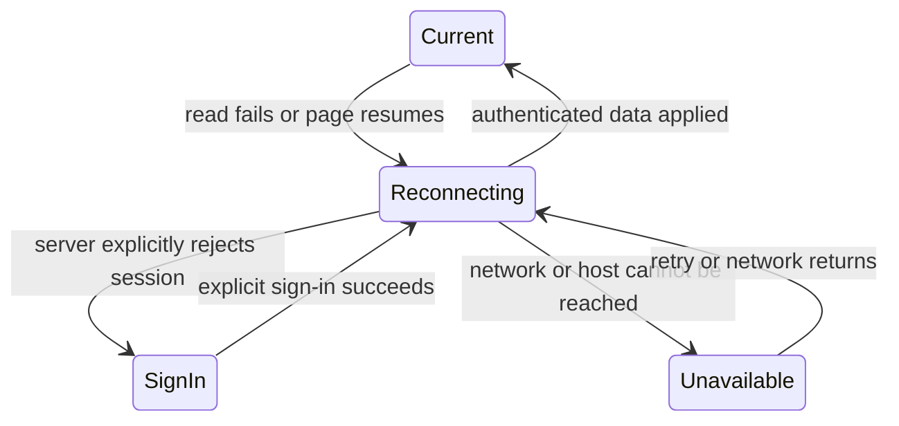

# Remote control v2 specification

Status: Draft proposal, 2026-11-12. Baseline: fetched `origin/develop` at
`dfcca45bfcbb31ddc8ad91954a26f8024e8d6128`.

## Purpose and source

Make the phone a dependable way to return to Koinon during two days away:
open the saved dashboard, see what needs attention, and act without repeated
pairing or losing work when the network changes.

Andrew requested a new branch and worktree from the latest repository, longer
lasting remote control, and a v2 specification on 2026-11-12. This draft interprets
longer lasting as both remembered sign-in and reliable service recovery. The
user then chose 48 hours for someone away from the host. This
draft uses a fixed 48-hour sign-in window from authentication, with no automatic
extension. Other interfaces and delivery order below remain recommendations;
the request authorizes specification work, not acceptance of every proposal.

Current behavior is defined by [PDR 010](product/pdr/010-private-remote-dashboard-access.md)
and [ADR 002](architecture/adr/002-private-remote-dashboard-transport.md).
This draft does not amend those accepted records. Record the selected v2 behavior
and mechanism there during implementation, with their decision sources under WDR 001.

## Baseline and proposed outcome

| Area | Current baseline | Proposed v2 |
| --- | --- | --- |
| Remote sign-in | Seven-day idle and absolute limits; session hashes in memory | Stay signed in for 48 hours from sign-in; durable session records |
| Restart or routine upgrade | Listener restores; every login ends | Phones remain signed in within the original 48-hour window for the same host, origin and password |
| QR pairing | One use, two-minute ticket; password fallback | Keep this flow; show the 48-hour expiry after sign-in |
| Lost phone | Logout, password change or disable can end access | Named browser-session list; revoke one device or all remote devices |
| Background and reconnect | Five-second visible refresh, stale after 15 seconds | Retain these rules; restore the current screen and recover drafts explicitly |
| Interrupted write | Result unknown; manually inspect target | Durable action receipt for supported operations; explicit recovery using the same operation ID |
| Phone start screen | Existing full dashboard | Attention view for pending decisions, unread messages and observed agent problems |
| Diagnostics | Host readiness and phone verification separate | Add session expiry/revocation reasons and observed reconnect evidence |

Baseline sources: [remote guide](REMOTE-DASHBOARD.md),
[authentication](../internal/core/dashboard_auth.go),
[cookie issuance](../internal/core/dashboard.go),
[remote lifecycle](../internal/core/remote.go), and
[browser refresh](../internal/core/web/static/app.js).
The current cookie already has a seven-day Max-Age. The missing server persistence
is a separate issue from browser cookie lifetime.

The [earlier verification notes](sprints/2026-11-11-remote-dashboard/verification.md)
record reported phone QR and Wi-Fi-off success, an unexplained short sign-out,
and an unreported one-hour background test. These are historical observations,
not proof of v2 retention or completion of the device acceptance matrix.

## 1. Stay signed in for 48 hours

Remote password and QR sign-in both start a fixed 48-hour session. Show **Signed
in until TIME** and **Forget this phone** in remote account settings. Activity,
background polling, reconnects and daemon restarts do not move that deadline.
There is no longer-duration checkbox or separate remember-device mode. Local
browser and maintainer API-token policies remain as defined by PDR 009.

Keep the current automatic, one-use QR redemption, including immediate fragment
removal and a ticket held only in page memory. A two-minute QR ticket starts the
same 48-hour session as password sign-in; it does not expire that session after
two minutes. Opening or previewing the landing page alone consumes nothing.

| Rule | Proposed value or behavior |
| --- | --- |
| Session expiry | 48 hours from original authentication, regardless of activity |
| Cookie lifetime | Remaining time until that fixed deadline; no sliding renewal |
| Automatic polling and foreground use | Never extend the deadline |
| QR ticket | Still one use and two minutes; the ticket is never the durable credential |
| Ordinary restart, host reboot, routine upgrade | Preserve login until its original deadline when private state, password and configured origin remain valid |
| Logout or device revocation | End that browser session durably |
| Password change, remote disable, external origin change | Revoke all remote sessions and pending tickets |
| Temporary Tailscale/network outage | Mark unavailable, preserve credentials until expiry; retry reads when the same configuration recovers |
| Mapping or identity conflict | Stop serving under existing ownership rules; require reconciliation before use; origin changes revoke sessions |
| Browser clears cookies or uses a different browser profile | Sign in again; server persistence cannot recreate a deleted credential |

Expiry checks use server time. An expired session cannot be revived by a delayed
request or a clock rollback; test clock discontinuities. After 48 hours, require
fresh password authentication or a new locally issued QR. Password sign-in stays
available remotely, so the user does not need to return to the host to sign in.
Preserve the current screen and draft through sign-in without replaying actions.

Browser cookie storage is conditional on browser behavior and user settings;
persistent server state alone cannot guarantee retention. See the
[MDN cookie guide](https://developer.mozilla.org/en-US/docs/Web/HTTP/Guides/Cookies).
Test Safari tabs, Chrome tabs and home-screen launches separately; do not assume
they share the same cookie storage.

## 2. Durable remote session storage and device management

Use the daemon's existing private SQLite store for remote browser sessions.
Retain an opaque random bearer cookie and store only its hash. Each row contains:
non-secret session ID, token hash, remote origin, credential generation binding,
created time, last observation, fixed expiry,
user-supplied device label, and revocation state. Never persist QR tickets or raw
cookies. The generation binding must detect a password change even when it occurs
while the daemon is stopped; it is not the password or an independently reusable
credential. Define the binding against the actual secret store during implementation.

Commit issuance before returning the cookie. Commit revocation before reporting
success. Successfully committed revocations must survive restart. If a write
fails, invalidate access in memory immediately and report **Revocation incomplete;
private storage could not be updated**. An in-memory denial cannot promise
revocation after restart; keep the failure visible and require a successful
durable retry before claiming the device is forgotten. Coordinate password changes with session invalidation so crash
recovery also observes the new credential generation. Keep the store within the
existing private-file permissions and ADR 001's same-user trust boundary.

Keep local and API sessions in memory. Separate durable remote-session
capacity from the existing shared 16-login pool. Recommend up to 32 remote
sessions; at capacity, show the device list and require selecting one to forget,
so pairing another browser cannot silently evict the everyday phone. This is an
engineering bound proposed here, not an existing maintainer decision.

**Settings → Signed-in remote devices** lists label, created time, last
observed use, expiry and **This browser**. Allow rename, revoke one and revoke all
remote sessions through existing authenticated, origin-checked CSRF actions.
A device is a browser session, not proof of physical hardware identity. Browser
names are hints; avoid fingerprinting or IP-address identity claims. A last-use
time is an observation, not proof that a person is currently online.

Split transport shutdown from credential revocation. The current
`closeRemoteLocked()` calls `endRemote()` even during daemon shutdown; that path
cannot remain the universal credential-deletion hook. Ordinary shutdown and
temporary dependency loss close the listener while retaining durable logins.
Explicit disable and origin/password changes also revoke credentials durably.
Test each lifecycle path independently, including existing conflict handling.

The per-start CSRF key may remain ephemeral: after restart, reads load a fresh
form/token for the surviving session. Old CSRF submissions return a recoverable
form-expired response. Preserve the draft and require explicit submission after
refresh; never bypass CSRF or replay a form to hide the restart.

On first upgrade to v2, require a fresh sign-in to start the 48-hour policy. Do
not extend an existing seven-day cookie or resurrect a cookie whose v1 memory
record is gone. Rollback to a binary without durable sessions requires
sign-in again. Session tables must not prevent supported rollback from opening
the database; include schema compatibility in upgrade evidence.

## 3. Reconnect without losing the task

Retain read-only refresh and the existing no-write-replay behavior. After a tab
returns to the foreground, immediately check authentication and displayed state.
Keep host reachability, authentication and displayed-data freshness separate:

A timeout is not a sign-out. Show **Cannot reach host · last updated TIME** when
unreachable, and **Sign in again** only after an explicit authentication result.
Use retry delays of 1, 2, 5, 10, then 30 seconds with jitter while visible. Reset
after success; stop background polling. Retain the 15-second stale threshold and
measure freshness from the last applied data, including when forms hold refresh.

Offer **Save drafts on this browser** in remote settings, off initially. When
selected, persist unsent message and decision-feedback text in browser storage,
scoped to host, remote-session ID, route and target. Restore with **Recover
draft**, never automatically send. Expire drafts after seven days and clear on
successful submit, logout, observed revocation or explicit clear. Explain that
local browser storage contains private text; do not save passwords, QR tickets,
cookies, API secrets, or complete private dashboard responses. Storage quota or
access failures leave the form usable and show that recovery is unavailable.
A browser offline at server revocation cannot clear storage until reconnect;
server revocation does not promise remote erasure of that browser's data.

## 4. Know whether an action happened

Add operation receipts first for remote message send, room post and decision
verdict. An operation has one client-generated ID, host, authenticated session,
operation type, target and payload digest. The deduplication namespace is the
host and operation ID; the issuing session is attribution, not a namespace that
changes on reauthentication. Record the accepted receipt and mutation in one
transaction for every operation included in this scope. If a handler cannot
provide that atomic boundary, keep it outside receipt-supported retries. Reusing an ID
with changed content returns a conflict. Same-ID retries return the original
result, including existing revision-conflict outcomes.

Retain receipts for seven days; show **Sending**, **Accepted**, **Conflict**, or
**Result unknown**. Accepted means the host recorded the action; show message
receipt and acknowledgement separately. After reconnect or reauthentication,
resolve pending IDs through an authenticated host-scoped lookup. Newly signed-in
maintainer sessions can inspect their host's receipts without gaining access to
other hosts. Receipt lookup checks current authentication and remote origin.

Never resubmit automatically. After an authoritative lookup in this atomic receipt store finds no receipt,
offer an explicit retry using the same ID while its receipt window is valid.
An in-flight original request and that retry must share server-side deduplication;
a missing receipt alone does not mean the original request has stopped. After
that window, require inspection of current target state; do not claim a safe
retry. Store pending IDs without message bodies unless draft saving was selected.
Keep receipts private and include opaque IDs, not contents, in diagnostic logs.

Launch, terminal input, stop/restart and remote disable need separate external
side-effect reconciliation before the receipt mechanism can cover them. They
retain honest unknown-result behavior in v2. Exactly-once execution for those
actions is not a v2 promise.

## 5. A phone view for work that needs attention

Add **Attention** as the remote landing page, with links to the full dashboard:

- Decisions awaiting the maintainer, showing count and oldest waiting age.
- Unread direct and room messages, with explicit mark-read behavior per browser.
- Agent problems supported by actual observations, with unknown values labeled.
- Recent action outcomes, including unresolved operation receipts.

Keep counts tied to the same source snapshot, show last refresh time, and link
to each source record. Define unread cursors per browser session; this view must
not acknowledge agent inbox messages or resolve decisions merely by reading them.
An unavailable observation must not appear as a healthy zero.

Use the existing compact dark dashboard style, muted labels, cyan identifiers,
and green/yellow/red states paired with text. Preserve current desktop and VS Code
typography. Keep 44-pixel touch targets, 16-pixel form text, readable long proposals,
and 360-pixel layouts with the software keyboard open. A copied link opens the
specific screen after authentication, using validated relative return paths.

A home-screen manifest and icons are useful after normal browser reliability is
proven. Test the installed launch separately. Do not cache authenticated pages or
add background-write queues. Push notifications, terminal streaming, remote host
wake and a multi-host hub are candidates for later work with their own scope;
they are not required to deliver durable dashboard access.

## 6. Lifecycle and diagnostics

Continue using Tailscale Serve and the dedicated dashboard-only listener. Serve
is private to the tailnet, as described in its
[official documentation](https://tailscale.com/docs/features/tailscale-serve).
Preserve mapping ownership, selected HTTPS port, backend port and existing
conflict handling. Koinon does not change Tailscale account/network policy or host
sleep settings as part of retaining a browser session. The host must be awake and online.

Extend existing status with observed remote-session count, durable-store health,
last successful reconciliation and a reason when authentication ends. Provide
stable reason codes for session expiry, revoked device, password
change, remote disabled, origin changed and unknown credential. An unknown cookie
after state loss must remain unknown, rather than inventing its history. Public
sign-in pages give a generic explanation; authenticated settings and private
audit provide available details without exposing a session inventory.

Distinguish **Host configured**, **Phone connected at TIME**, and **Cellular access
reported/tested at TIME**. A browser request proves only reachability at that
moment, not cellular use or permanent availability. A client clock and a server
observation must be labeled separately. Diagnostics exclude secret values,
private message text, QR fragments and session token hashes.

## Delivery order

| Increment | Deliverable | Completion evidence |
| --- | --- | --- |
| 1 | Reproduce and instrument unexpected sign-out; implement durable 48-hour login and device revocation | Boundary-time, crash, restart, upgrade and credential-change tests; real-phone one-hour resume |
| 2 | Connection-state recovery and optional durable drafts | Interrupted network, discarded tab, storage failures and fresh CSRF form recovery on both phone browsers |
| 3 | Transactional receipts for messages, room posts and verdicts | Lost-response and duplicate-ID tests; original host mutation appears once |
| 4 | Attention view and consolidated diagnostics | Counts match source state; unread actions do not acknowledge agent inboxes; mobile workflow acceptance |

These are dependency increments, not a committed number of PRs. Use the project's
sprint workflow for an implementation spanning multiple PRs. Keep the one-open-PR
policy and independent review gates. Update usage, protocol, changelog and affected
accepted records alongside implementation. The present change is a draft document;
it does not change released behavior or warrant a release-note feature claim.

## Acceptance criteria

| ID | Required evidence |
| --- | --- |
| AUTH-1 | Fake-clock tests just before and at 48 hours from sign-in; polling, foreground activity, reconnect and restart never extend expiry. An expired cookie requires fresh sign-in. |
| AUTH-2 | Remote login survives orderly restart, abrupt daemon death, host reboot and supported upgrade only within the original 48-hour window; local/API policies remain unchanged. |
| AUTH-3 | Logout, individual/all-device revocation, password change while running/stopped, disable/re-enable and origin/port change reject old credentials across restart. Test crash boundaries and failed storage writes. |
| AUTH-4 | Forged origin/forwarding headers, CSRF, cookie crossover, QR replay and remote `/v1/` access still fail. Raw credentials never enter persistent session rows or logs. |
| AUTH-5 | Capacity is explicit; pairing does not silently evict remote sessions. Corrupt/missing store fails with actionable diagnostics and cannot accept an unverified cookie. |
| PHONE-1 | Record actual iOS Safari and Android Chrome versions; QR and password sign-in, close/reopen browser, lock/unlock, one-hour background, overnight, return before 48 hours and return after expiry. One browser is not evidence for the other. |
| PHONE-2 | Wi-Fi to cellular and back, VPN disconnect/reconnect, offline startup and host sleep/wake preserve valid login; confirm host message receipt and recorded decision result. |
| FORM-1 | Restart with an open form refreshes CSRF and preserves text without submitting; draft opt-in/out, recovery, expiry, quota errors and logout cleanup behave as specified. |
| ACTION-1 | Drop response after host commit; lookup finds the original receipt. Concurrent same-ID submissions create one mutation; changed payload conflicts; expired receipts do not imply retry safety. |
| UI-1 | At 360/390 pixels, keyboard, zoom and long proposals remain usable; Attention counts agree with source state; unavailable observations are explicit. |
| LIFE-1 | macOS and Linux restoration, existing Serve mappings, conflicts and chosen HTTPS ports retain current ownership behavior; private diagnostics contain no credentials or message bodies. |

Automated clocks prove expiry rules; real-phone retention needs elapsed tests. Record
measured elapsed tests, simulated time, user reports and unavailable evidence
separately. Run project checks and applicable four-platform/native lifecycle
checks for implementation; CI and independent reviews bind to the final head.

## Tradeoffs and review points

Andrew chose 48 hours on 2026-11-12 after first suggesting about 24 hours. The draft therefore replaces its initial 90-day idle / one-year maximum
proposal with a fixed 48-hour window. This is shorter than the current seven-day
remote policy; the improvement is dependable access within those two days, including
through routine restarts. A sliding 48-hour idle timer could continue indefinitely
with regular use, so this draft uses an absolute deadline instead.

Persisted session hashes remove routine restart sign-outs while adding sensitive
state that must migrate and revoke correctly. Browser-cookie deletion, storage
partitioning, host downtime and Tailscale availability remain independent causes
of lost access. Diagnose the earlier five-minute report rather than claiming the
48-hour policy fixes it. Investigate authentication reason, host restart evidence,
origin changes and browser context with private captures before naming a cause.
