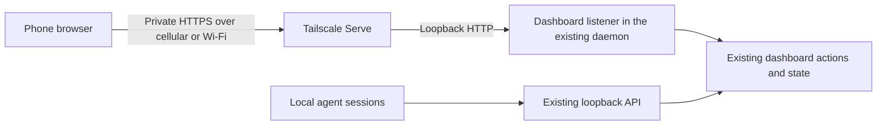

# Remote dashboard specification

Status: Draft proposal. Updated: 2026-11-10.

Koinon Remote lets the maintainer control the existing dashboard from a phone over
cellular or Wi-Fi away from home. The recommended first version uses Tailscale Serve
for private HTTPS access and Koinon's existing dashboard login. It runs with the
existing Go daemon and uses the same state and actions as the local dashboard.

## Confirmed scope

Andrew chose dashboard control after comparing dashboard, live terminal and desktop
control: “yeah lets start with just dashboard control.” He asked for the easiest
approach that fits the repository. He then clarified: “yes you do need access to
work away from home; that's important.” These choices were made on 2026-11-10.

The first version therefore includes dashboard control and access away from home.
Terminal streaming, terminal typing, desktop control, native phone applications,
push notifications and a combined view of multiple computers are outside this
version's deliverable. This scope does not prohibit adding them later.

The implementation choices below are recommendations, rather than accepted product
or architecture decisions. Record significant choices in the appropriate PDR and
ADR during implementation, following WDR 001. Cite ADR 001 for the current local
trust boundary and PDR 009 for the existing maintainer login and attribution.

## Recommended approach

Use the existing browser dashboard, with responsive layouts and a persistent HTTPS
URL supplied by Tailscale Serve. The phone and host computer join the same private
Tailscale network. Access also depends on that network's access policy.

Tailscale Serve provides HTTPS and access within the private network; its HTTPS
certificate prerequisites are part of setup. See the
[official Serve documentation](https://tailscale.com/docs/features/tailscale-serve).
The application still authenticates the maintainer using the existing secret.

This introduces an optional external Tailscale installation, without embedding a
VPN library in Koinon or operating a Koinon cloud service. The ordinary local
installation continues to work without Tailscale. The host must be awake, online,
and running both services for the phone to reach it; this version does not wake a
sleeping computer remotely.

## Setup and everyday use

Proposed commands below are new interfaces to implement, not commands available in
the current release.

1. Install Tailscale on the computer and phone and sign both into the same private
   network. Koinon links to the platform instructions when it is missing.
2. Run `koinon remote enable` on the computer. It checks that Tailscale is connected,
   the daemon is reachable, and a maintainer secret is set. If a secret is missing,
   guide the user through the existing secret setup without putting it in arguments.
3. Configure private HTTPS forwarding through Serve. If Tailscale needs account,
   certificate, or operating-system interaction, show the exact next step and let
   a repeated enable resume setup safely.
4. Print the stable dashboard URL and a QR code containing only that URL. The phone
   opens it and signs in with the maintainer secret. A bookmark or home-screen
   shortcut provides everyday access.
5. Report that the host is configured and offer a cellular verification step:
   turn off phone Wi-Fi and perform a dashboard action. Distinguish host readiness
   from verified phone access; this manual check does not block enabling access.

| Proposed command | Observable behavior |
| --- | --- |
| `koinon remote enable` | Configure access, or report what remains to finish; repeating it preserves a working setup. |
| `koinon remote status` | Show configured URL, local dashboard readiness, observed Tailscale and Serve state, and specific next steps. Mark phone reachability as unverified unless tested on the phone. |
| `koinon remote disable` | Stop the remote listener, end its browser sessions, and remove the Serve mapping owned by this feature. Local dashboard access stays available. |

Persist configuration in the existing private state directory. Daemon and host
restarts restore the configured listener and Serve forwarding without rerunning
enable. Preserve the listener port across restarts; report a conflict explicitly.
The URL remains stable while the Tailscale machine identity and hostname remain
the same. Explain how to obtain the new URL if those change.

Inspect existing Serve configuration before changing it. Preserve unrelated
mappings; when an existing mapping conflicts, explain the conflict rather than
resetting Serve configuration. Track the mapping this feature owns for disable,
upgrade, and uninstall. Disabling does not log the host out of Tailscale.

## Dashboard behavior on a phone

Reuse the existing routes, templates and action handlers. All existing dashboard
views and actions remain reachable. Prioritize these workflows in navigation:

| Workflow | Phone behavior |
| --- | --- |
| Agents | Inspect reported activity and context, open details, send an instruction, and use existing session controls. |
| Messages and rooms | Read retained messages, inspect delivery and acknowledgement, send messages, and manage rooms. |
| Decisions | Read the full proposal and history, then approve, decline, dismiss, or give feedback where the current action supports it. |
| Launch | Start an agent using the existing launch form and host-side directory rules. |
| Work, memory, audit and health | Browse existing information and use existing supported actions. |

Use compact dark surfaces, muted labels, cyan identifiers and status colors paired
with text. Keep desktop typography settings outside this change. Phone controls
have at least 44 CSS pixels of touch area and form text of at least 16 CSS pixels.
At 360 CSS pixels wide, primary workflows fit the viewport; long identifiers wrap
and secondary tables may scroll within their containers. Controls remain usable
with the software keyboard open and with browser zoom.

Show the host name, connection state and last successful refresh time. Use the
existing five-second visible-page refresh initially. Label data as stale after
15 seconds without a successful refresh; show unavailable observations as unknown.
A registered agent alone does not establish that the agent is busy.

Refresh immediately on foregrounding the page and after reconnecting. Preserve
the current screen, open forms and unsent text when replacing refreshed content.
Keep unsent text in page memory; this version does not promise recovery after the
browser discards or reloads the page. Do not cache private dashboard pages offline.

## Remote authentication and request handling

The recommended mechanism is a separate dashboard-only loopback listener inside
the existing daemon. Serve forwards to this listener. It mounts the dashboard and
its static assets, with `/` redirecting to `/dashboard/`; it does not mount `/v1/`
or provide the phone with the daemon API secret. Reuse dashboard handler logic
rather than introducing a second implementation of actions.

The listener accepts the exact configured external HTTPS host and validates write
origins against that origin. Define this origin from verified setup configuration,
not from arbitrary incoming `Forwarded` or `X-Forwarded-*` headers. Verify Serve's
actual backend Host behavior during integration; configure or validate that
behavior explicitly rather than silently weakening checks. Keep existing local
Host and Origin handling on the original listener (ADR 001, Decision 4).

Remote sessions use a distinct cookie name with Secure, HttpOnly, SameSite=Strict
and the dashboard path. Bind sessions to the remote surface so local cookies do
not authenticate remotely or vice versa. Login forms and state-changing actions
retain their origin checks; authenticated actions retain session-bound CSRF checks.
Proxy identity headers do not substitute for the maintainer login.

Reuse the current session limits: 24 hours idle and seven days absolute, with
logins ending on daemon restart or secret change (PDR 009). Remote disable or an
external-origin change also ends the remote logins. Never include credentials in
the saved URL or QR code. Tailnet access-policy setup should match the intended
maintainer devices, particularly when the network includes other users.

Phone actions retain maintainer authority and the existing audit and verdict
attribution under PDR 005 and PDR 009. A message submitted from the phone has the
same meaning as the equivalent local dashboard message. Network acceptance alone
does not identify a particular person or phone.

## Reconnection and uncertain action results

While a form submission is running, disable its submit button to prevent repeated
taps. Keep the existing POST then redirect behavior and revision checks.

If a response is lost, show “Result unknown; check the latest state before trying
again.” Reconnect and read the relevant decision, message, room or session state.
Do not replay a write automatically after timeout, login, or network recovery.
Use existing idempotency keys where provided; any new retry support must preserve
one operation's key. This version does not claim exactly-once delivery across
all existing dashboard actions.

Expired login opens the sign-in flow with a safe relative return path. Show the
pending screen after login, but do not submit the previous action. An offline
page displays its last known data with a stale label and offers reconnect.

## Acceptance and verification

| Check | Required result |
| --- | --- |
| Away from home | With phone Wi-Fi off, sign in over cellular, read agents, send a message and submit a decision verdict. Verify message receipt and the recorded verdict on the host. |
| Mobile browsers | Complete the core workflows in current iOS Safari and Android Chrome; record tested OS and browser versions. |
| Layout | Verify 360 and 390 CSS pixel widths, portrait and landscape, zoom, long content, and the software keyboard. |
| Authentication | Test correct and incorrect secret, expired session, secret change, logout, daemon restart and remote disable. |
| Request boundary | Positive tests for remote login and writes through Serve; negative tests for wrong origin, CSRF, forged forwarding headers, local/remote cookie crossover and `/v1/` on the remote listener. |
| State continuity | Local and remote browsers see the same actions, delivery state and verdicts; concurrent decision revisions produce the existing conflict response. |
| Reconnection | Switch Wi-Fi to cellular, background and resume, interrupt a submission response, and verify preserved forms, honest status and no automatic write replay. |
| Lifecycle | Enable twice; restart daemon and host; upgrade; disable twice; re-enable. Verify stable URL, configuration ownership, session invalidation and local dashboard availability. |
| Existing Serve setup | Preserve unrelated mappings and report a conflicting mapping without overwriting it. |
| Dependency failures | Missing Tailscale, signed-out host, missing certificate permission, denied network policy, unavailable daemon and occupied listener port each have actionable diagnostics. |

Use synthetic Go tests for handler, cookie, origin, configuration, retry and CLI
behavior, with an injectable Tailscale command adapter. Test the real proxy and
phone path separately on macOS and Linux hosts. Record unavailable platform
evidence explicitly; a local browser or mocked proxy does not replace it. Run
the project checks and four static builds for implementation changes (WDR 004),
including the native evidence appropriate to any service lifecycle edits (WDR 006).

## Implementation sequence

1. Prove real Serve forwarding to a dashboard-only handler, including Host,
   Origin, redirects and Secure cookies. Establish the platform setup commands
   and certificate prerequisites before automating them.
2. Add persistent remote configuration and enable, status and disable commands.
   Integrate restoration with the daemon and existing service lifecycle.
3. Adapt the existing dashboard for touch, connection reporting and reconnects.
4. Run the acceptance matrix, update usage, installation and protocol documents,
   and add the user-visible changelog entry. Record the resulting product and
   architecture decisions with their accepted scope.

These steps describe dependencies, not a committed number of pull requests. Use
the project's sprint workflow if implementation requires multiple pull requests.

## Alternatives considered

| Alternative | Tradeoff |
| --- | --- |
| SSH tunnel from the phone | Fits today's loopback dashboard, but makes everyday phone setup and connection management harder. |
| Public relay with device pairing | Can remove the phone VPN dependency, but adds relay operation, pairing, credential lifecycle and a broader authentication design. |
| Embed Tailscale in the Go binary | Can integrate networking more deeply, but adds dependency and network lifecycle complexity to Koinon. |
| Forward the original daemon port | Saves a listener, but mixes remote browser acceptance with the private agent API boundary. A dedicated dashboard handler is easier to verify. |
| Native phone application | Adds packaging and release work while duplicating an existing web interface. |

The recommendation optimizes setup and repository maintenance for the confirmed
dashboard scope. It requires Tailscale on both devices and an awake host. A future
requirement for browser access without a phone VPN would reopen the transport choice.
